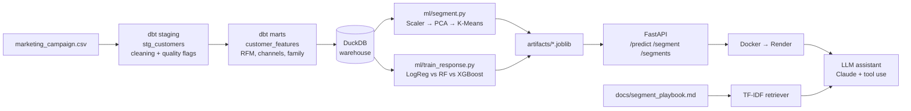

# Customer Intelligence Pipeline

[](https://github.com/xiaohanBeatrice/customer-intelligence/actions/workflows/ci.yml)

An end-to-end customer analytics project: raw CSV → tested data models in **dbt + DuckDB** → **customer segmentation** and a **campaign response model** → a **FastAPI** service deployed with **Docker** → an **LLM marketing assistant** that calls the API and retrieves from a strategy playbook (RAG).

**Live API:** https://customer-intelligence-h23l.onrender.com/docs
<sub>Hosted on a free tier: the first request after 15 minutes of inactivity can take 30–60 seconds while the service wakes up.</sub>

> **Note:** This is a portfolio project built on the public Kaggle dataset [Customer Personality Analysis](https://www.kaggle.com/datasets/imakash3011/customer-personality-analysis) (2,240 customers of a retail company, 2012–2014). It is a demonstration of methods, not an analysis of a real business.

---

## Results at a glance

| | |
|---|---|
| **Segments** | 4 customer segments; the top two (47% of customers) generate **87% of revenue** |
| **Response model** | XGBoost, test **ROC-AUC 0.90**, **PR-AUC 0.68** (random baseline 0.15) |
| **Business impact** | Contacting the top 20% of customers by predicted probability reaches **70% of responders** |
| **Data quality** | 9 issue types found and handled; 15 automated dbt tests |
| **API** | 13 pytest tests, including a check that API features match the training features exactly |
| **LLM assistant** | **20/20** questions passed on an automated evaluation set (tool choice and answer content) |

---

## Architecture



Every push to `main` runs the full pipeline in GitHub Actions: lint → `dbt build` → train both models → `pytest` → `docker build`. Render redeploys after the checks pass.

---

## 1. Data cleaning (dbt + DuckDB)

The raw file is read directly by dbt and never modified. `models/staging/stg_customers.sql` renames columns and handles data quality issues found through systematic profiling (single-column checks, cross-column logic checks and duplicate checks):

| Issue | Finding | Decision |
|---|---|---|
| Missing income | 24 rows | Kept as null, flagged; imputed later inside the model pipeline |
| Income outlier | One value of 666,666 (next highest 162,397) | Set to null as an entry error |
| High incomes | 7 customers above the IQR fence (118,351), several with almost no spend | Kept and flagged |
| Invalid birth years | 1893, 1899, 1900 | Set to null |
| Marital status | `Alone`, `Absurd`, `YOLO` | Mapped to `Single` |
| Education `2n Cycle` | Not defined by the dataset | Kept as is; grouped below Graduation because its income and spend sit below that level |
| Constant columns | `Z_CostContact`, `Z_Revenue` | Dropped |
| Logical contradictions | 7 rows with spend but no purchases, or more deal purchases than total purchases | Flagged and excluded from modelling |
| Possible duplicates | 182 extra copies (identical except ID) | Flagged and kept |

Errors are set to null; uncertain records are kept with `is_*` flag columns rather than deleted, so every decision is reversible and visible.

## 2. Features (dbt marts)

`models/marts/customer_features.sql` builds one row per customer with 50+ features: age, family size, tenure, total spend, spend mix by category, channel shares and preferred channel, deal share, average order value, campaign history and RFM scores. Ages and tenure use the last enrolment date in the data (2014-06-29) as the reference, not today's date.

Recency alone is a strong signal: the most recent fifth of customers respond at **~29%**, versus **~6.5%** for the least recent fifth.

## 3. Models

**Segmentation** (`ml/segment.py`): StandardScaler → PCA (3 components) → K-Means (K = 4) on eight features. K = 2 had the highest silhouette score, but K = 4 was chosen because the groups are easier to act on. Segments are named by rule (spend rank, then age), so names stay correct across retraining.

| Segment | Customers | Share of revenue | Avg income | Response rate |
|---|---|---|---|---|
| Affluent High-Value | 24.4% | 52.4% | $76,767 | 24.1% |
| Established Families | 22.4% | 35.0% | $60,896 | 17.4% |
| Price-Sensitive New | 26.3% | 6.8% | $42,863 | 4.3% |
| Young Online Browsers | 26.8% | 5.8% | $30,806 | 15.6% |

**Campaign response** (`ml/train_response.py`): predicts whether a customer accepts the next campaign (15% positive class). A 20% test set is held out; the three candidates are compared with 5-fold stratified cross-validation on the training set only.

| Model | CV ROC-AUC | CV PR-AUC |
|---|---|---|
| Logistic regression | 0.891 ± 0.027 | 0.643 |
| Random forest | 0.899 ± 0.012 | 0.631 |
| **XGBoost** | **0.906 ± 0.016** | **0.664** |

XGBoost on the test set: ROC-AUC 0.901, PR-AUC 0.683. Accuracy is not used as the headline metric because predicting "no response" for everyone would already score 85%.

## 4. API (FastAPI + Docker)

| Endpoint | Purpose |
|---|---|
| `GET /health` | Service status and model info |
| `GET /segments` | Profiles of the four segments |
| `POST /segment` | Assign a customer to a segment |
| `POST /predict` | Response probability and segment for one customer |

```bash
curl -X POST https://customer-intelligence-h23l.onrender.com/predict \
  -H "Content-Type: application/json" \
  -d '{"birth_year": 1970, "education": "PhD", "marital_status": "Single", "income": 85000,
       "enrolled_date": "2012-09-01", "recency_days": 5, "spend_wine": 900, "spend_meat": 600,
       "purchases_catalog": 7, "purchases_store": 10, "purchases_web": 6, "accepted_cmp1": 1}'
```

Inputs are validated with Pydantic (types, ranges and allowed values); invalid requests return 422.

**Training–serving consistency.** The API recomputes features in Python (`api/features.py`) for customers who are not in the warehouse. `api_tests/test_features.py` compares these against the dbt features for all 2,205 model-ready customers. It caught a real bug: Python's `round()` uses banker's rounding while SQL rounds half up, which made average order value differ by 0.1 for some customers. The fix is a `round_half_up` helper; both sides now match exactly.

## 5. LLM marketing assistant (Claude + tool use + RAG)

`llm/assistant.py` gives Claude three tools and lets it decide which to call:

| Tool | Source |
|---|---|
| `search_playbook` | TF-IDF retrieval over `docs/segment_playbook.md` (segment profiles, strategies, model guidance, limitations) |
| `get_segment_profiles` | Live `GET /segments` call to the deployed API |
| `predict_customer` | Live `POST /predict` call to the deployed API |

The playbook is in English while users may ask in Chinese. Instead of adding an embedding model, the system prompt tells Claude to always write search queries in English, then reply in the user's language.

**Evaluation** (`llm/eval.py`): 20 questions covering segment facts, cross-segment insights, model interpretation, strategy, single-customer predictions and one out-of-scope question. Each answer is checked for the right tool and for key facts. Result with Claude Haiku: **20/20 passed**, average 5.5 s per question. An earlier run exposed an empty final answer after a successful tool call; the assistant now re-prompts once and logs `stop_reason`.

---

## Run it locally

```bash
git clone https://github.com/xiaohanBeatrice/customer-intelligence.git
cd customer-intelligence
python3.12 -m venv .venv && source .venv/bin/activate
pip install -r requirements-dev.txt

dbt build                         # clean data, build features, run data tests
python ml/segment.py              # train segmentation
python ml/train_response.py       # train response model
pytest                            # API and retriever tests
uvicorn api.main:app --reload     # open http://127.0.0.1:8000/docs
```

For the assistant, create a `.env` file with `ANTHROPIC_API_KEY=...` (never commit it), then:

```bash
python -m llm.assistant           # interactive chat
python -m llm.eval                # 20-question evaluation
```

## Project structure

```
├── data/raw/                 raw CSV (read-only)
├── models/staging/           dbt: cleaning + quality flags
├── models/marts/             dbt: customer features
├── tests/                    dbt custom data tests
├── ml/                       segmentation and response model training
├── artifacts/                trained models and metrics
├── api/                      FastAPI service and feature builder
├── api_tests/                pytest suite
├── llm/                      retriever, assistant and evaluation
├── docs/                     segment playbook (RAG knowledge base)
├── Dockerfile
└── .github/workflows/ci.yml
```

## Limitations

- Public demonstration dataset from 2012–2014; not real company data.
- The dataset does not say whether `Recency` was measured before or after the last campaign. If after, the model's accuracy may be overstated.
- Segment strategies in the playbook are data-driven hypotheses and have not been tested in live campaigns. Detecting a lift from 15.6% to 20% response with 80% power needs about 600 customers per group.
- The assistant's evaluation checks for key facts with rules; it does not grade the full quality of each answer.

## Next steps

- Add an LLM-as-judge evaluation for answer quality and a larger question set.
- Calibrate predicted probabilities and choose the targeting cut-off from campaign cost and expected revenue.
- Track model performance over time and retrain when new campaign results arrive.
